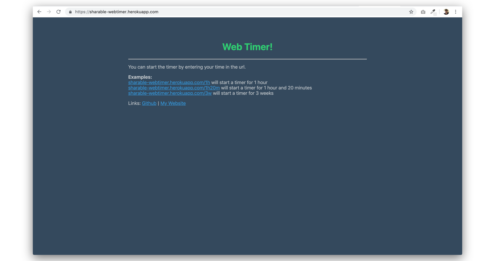
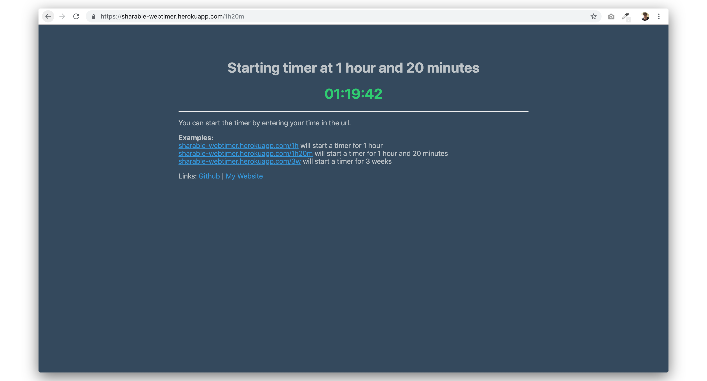

# Webtimer
This is a web timer which you can give a URL like ./1h30m1s and it'll set a timer for 1 hour, 30 minutes and 1 second.
which makes it amazing for bookmarking.

## Home Page

## Countdown Page

